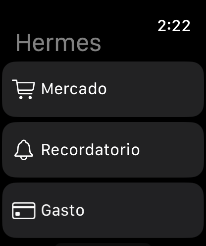

# Three-action MVP verification · 25 October 2026

> Historical verification for the pre-rename candidate. The current product is Personal Watch App; see the [October 28 rename verification](../2026-10-28/REPORT.md). Artifact names, hashes and the earlier screenshot below retain their original meaning.

Delivery state: **ready for code review; physical/live acceptance pending**. No backend was deployed, no live domain was exercised, and no financial records or production credentials were used.

The later request to complete Xcode/device setup is tracked in [the device setup record](../../XCODE_DEVICE_SETUP.md) and [setup results](SETUP_RESULTS.json). The original signing result below is historical: a signed iOS/embedded-Watch build now passes with renewed profiles and the existing certificate, and iPhone installation/launch are verified. Direct Watch installation is blocked by a Bluetooth pairing-connection rejection; physical Watch readback and visible Xcode selection remain pending.

## Candidate identity

- Base: `970e14dfd6d3788996135a933cc0909c3049f076`.
- Reconciled source: recovered September 5 non-Git `0.3.4 (7)` candidate, against canonical main `0.3.3 (6)`. Only reviewed necessary source was imported; generated projects/builds, private configuration and signing material were excluded.
- Recovered manifest SHA256: `a07562867cd5cf9639778093419bffd864f4c67f0efd4f079b6a90a6bb5ca1c6` (86 files present, 85 matching). The one preexisting edited outbox test remained untouched in the external original: SHA256 `6bd0c98a28c0ab150fbba70fa3f4f9ced828451102bca7792b60b87e21d038c4`.
- This is a **new reconciled candidate**. No equivalence with historical bundle `9b0b397a…` is claimed. Existing historical documentation remains intact.
- [SOURCE_MANIFEST.json](SOURCE_MANIFEST.json) pins the implementation files. The PR commit and deterministic archive produced by `python3 scripts/freeze_mvp_candidate.py` identify the complete deliverable. Archive output stays local under `.private/` and contains only the committed Git tree.

## Fresh results

| Check | Actual result |
| --- | --- |
| Backend, Python 3.9.6 | **104 passed**, including signed loopback HTTP and actual expense-helper subprocess → fake Firefly → COP journal readback; zero live services. |
| Swift package on Apple toolchain | **58 passed**; 16 contract, 23 delivery, 19 safety tests. |
| iOS simulator core tests | **58 passed** using the empty offline test host. |
| iPhone simulator UI | **8 passed** in the final combined scheme run, plus an earlier separate 8/8 run. |
| iOS unsigned Release device build | **Passed**, including embedded Watch app. |
| Standalone watchOS unsigned Release device build | **Passed**. |
| Watch simulator | Synthetic app installed and launched; home screenshot visibly shows only Mercado, Recordatorio and Gasto. Interactive Watch gestures were not verified. |
| Signing/archive | Attempted with existing configuration; **blocked** because both product targets require a development Team. No provisioning updates, account changes or bundle-ID changes were made. |
| Physical installation, Siri and actual alerts | **Not run**. These gates require Jose's device participation and separately authorized live-domain checks. |

Toolchain: installed Xcode **27.0 (27A5237l)**, iOS/watchOS SDKs **27.0**, XcodeGen **2.46.0**. Actual simulator destinations: **iPhone 17 Pro, iOS 27.0**, and **Apple Watch Series 11 (46mm), watchOS 27.0**. Device identifiers are omitted. `DEVELOPER_DIR` was command-scoped; global Xcode selection was unchanged.

The original logic-test runner and then the full product app test host stalled before test execution. An empty offline `HermesCoreTestHost` resolved startup; the final integrated scheme executed both all 58 core tests and all eight UI tests successfully. The test host never initializes product configuration, App Intents or WatchConnectivity. Native Mac GUI automation was unavailable while the Mac was locked; the Watch check used headless simulator installation/launch and a screenshot only.

## Safety boundaries exercised

| Boundary | Current evidence |
| --- | --- |
| F1 · COP agreement | Missing/unknown/non-COP/contradictory source currency rejected; COP frozen into hash/confirmed plan/payload/readback; legacy missing-currency writing/uncertain never reposts. Explicit foreign-currency dictation is rejected. |
| F2 · Durable cancellation | Atomic per-operation cancellation tombstone and retry suppression; cross-instance claim races, persistence failure, failed/lost-ACK and sending/relaunch cases; no promise of reversal. Physical gate remains open. |
| F3 · Multiple amounts | Detection precedes range filtering, including an invalid second amount. |
| F4 · Explicit account | Unknown or ambiguous explicit account clauses, including `en mi RappiPay/PayPal`, never silently select the default. |
| F5 · Terminal preview | Correlated 200/422 rejection persists invalidation; unrelated/network errors preserve a valid preview. Late in-flight previews after cancellation/rejection are neutralized before reaching UI. Repeated token refreshes do not revive stale permission. |
| F6 · Inactive replay | Neutral same-identity inactive response, no token/confirmation, no denial of a prior expense. Covered cached and missing/processing request-row recovery for committed/writing/uncertain operations. |
| Exactly once | Canonical confirmation request IDs after double taps/relaunch; serialized claims; fake ACK loss and server cancel/confirm CAS winners; one helper/Firefly write with canonical readback. Watch initial offline retries now retain their original request ID. |
| Reminder scope/date | Create-only timed route, unsupported/ambiguous/multiple/past schedules rejected, relative time frozen to capture time, checked again at dispatch, helper due agreement required. Alert verification stays explicitly false. |
| Mercado scope | Add-only helper authority; complete/remove/bought semantics rejected; unsupported route contexts cannot acquire a write through fallback. |
| General capture | No Argos dispatch implementation/toolsets imported. Only three visible actions/shortcuts; old general intent returns an out-of-scope message. |

The eight UI cases exercise three-action scope, Mercado committed copy, reminder Bogotá/pending-alert copy, expense preview plus explicit confirmation, cancellation/relaunch, offline confirmation then cancellation/relaunch, expired preview/relaunch, and repeated confirmation taps. Watch retry/history now preserve the returned business result rather than replacing it with a transport count.

Independent Sol Ultra review reproduced account/currency/time-ambiguity/replay/retry/late-response gaps before correction, and verified their fixes. The final targeted recheck reported no remaining actionable findings. This is code/synthetic verification, not a certification of the external adapters or physical devices.

## Privacy and publication

Both unsigned Release products contain the shared privacy manifest (`NSPrivacyTracking=false`, UserDefaults reason `CA92.1`). Product bundle IDs, companion relationship and `0.3.4 (7)` are preserved. Device/Release binaries exclude the Debug/simulator synthetic host, fake endpoint and fake secret. The resumed setup also verified privacy manifests in both signed Debug device app bundles; a separate signed archive was not created.

Synthetic mode uses isolated per-case outboxes and an intercepting URLProtocol; retries, bootstrap and configuration paths cannot send to actual services or save real credentials in that mode. Real Keychain/bootstrap authentication and server-owned gates are retained.

Raw build/test logs and `.xcresult` bundles remain local under `.private/verification/`; only sanitized summaries, source hashes and the synthetic Watch screenshot are published. GitHub identity/repository were checked; before publication the repo had no Actions workflows, webhooks, Pages site or deployments. No preview deployment is configured by this diff.

The source manifest uses separate `path` and `sha256` fields. GitGuardian initially classified a source digest next to the filename `KeychainRouteSecretStore.swift` as a generic secret; recomputing the source-file SHA256 proved its identity. The manifest representation was corrected without introducing a security-check exclusion or changing scanner permissions.

## Reproduce and continue

From a clean checkout with the installed Xcode/runtimes:

```bash
HERMES_VERIFICATION_OUTPUT=.private/verification/reproduction-001 bash scripts/verify_mvp.sh
python3 scripts/freeze_mvp_candidate.py
```

Use a fresh verification output directory for each run. The verification script performs synthetic tests and unsigned builds only. It does not start a production backend, read a `.env` file, sign/archive, install on physical hardware, or publish anything. Local sandbox execution may require the normal native approval for compiler/simulator services and loopback sockets.

Before personal use: review the PR, complete the [current signed-device setup](../../XCODE_DEVICE_SETUP.md), verify the exact external Aura helper and its official-list/create-only/frozen-schedule/idempotency contract against fake services, authorize any backend rollout separately, and follow [the physical/notification handoff](../../HERMES_PERSONAL_MVP.md). Actual Calendar alarm readback and observed alert arrival are mandatory; Notion Task creation alone does not close the reminder gate.


